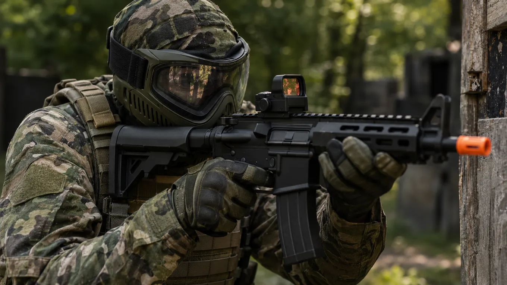
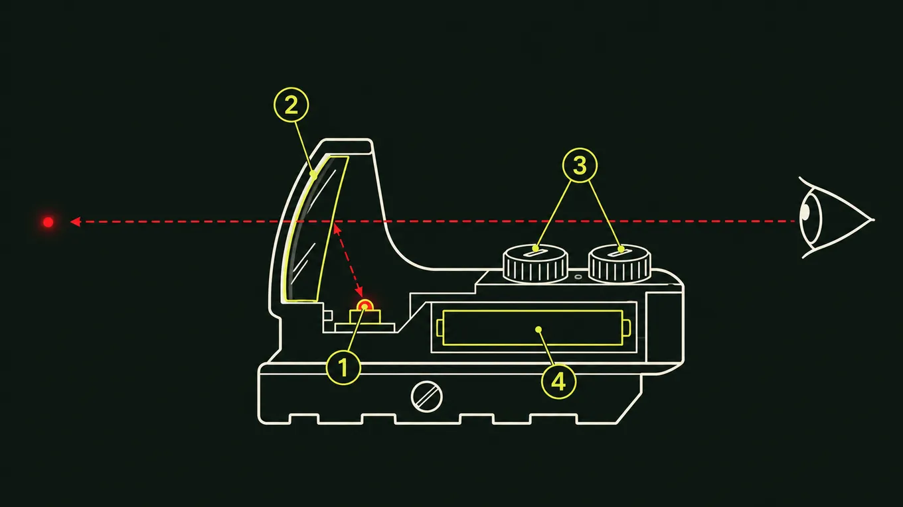
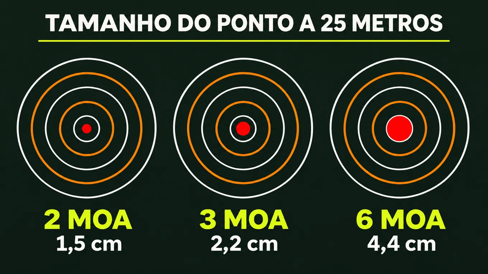
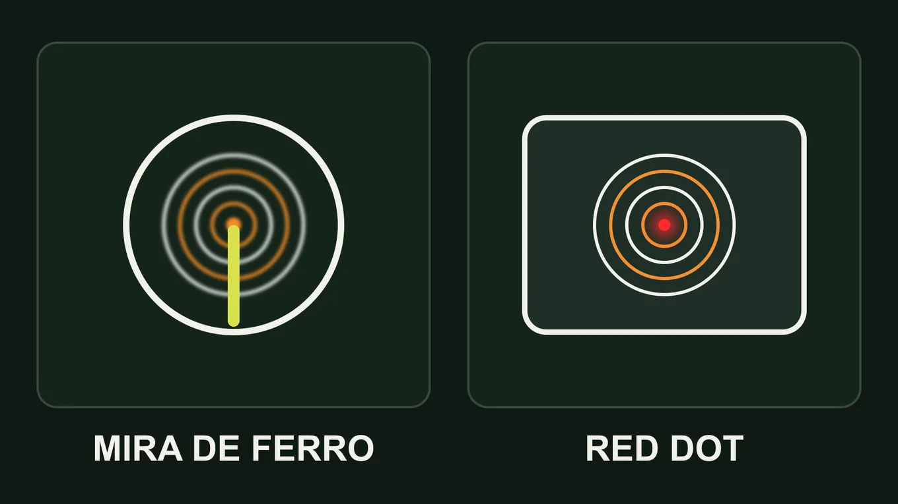
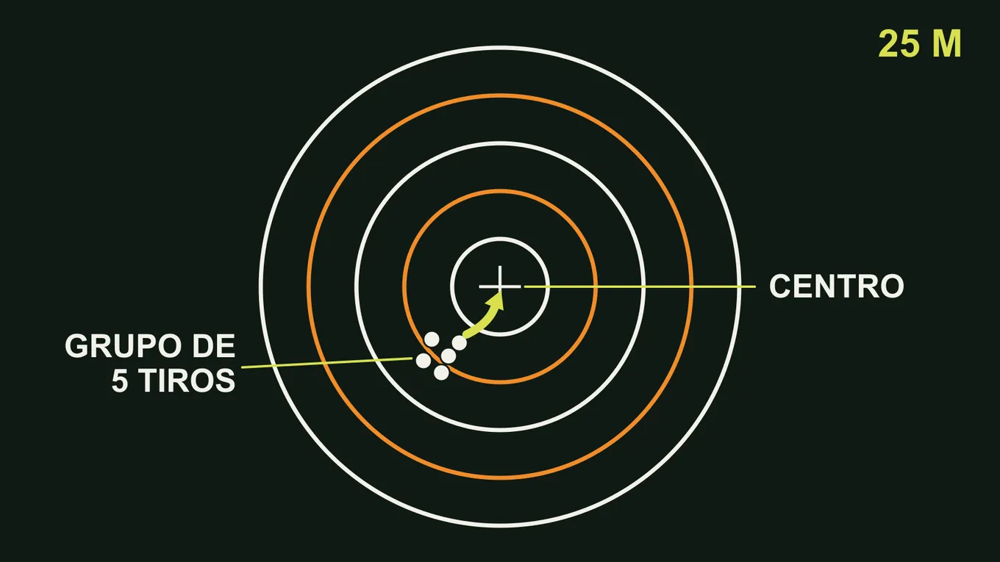

O red dot é a mira mais comum no airsoft, e por um bom motivo: em poucos
minutos qualquer jogador aprende a acertar mais rápido com ele do que com a mira
de ferro. Mas existem muitos modelos, números como "3 MOA" na caixa e um passo
que quase todo mundo erra no começo: **zerar a mira**.

Este guia explica o que é um red dot, como ele funciona, quais são os tipos, o
que significam os números, como escolher e como deixar a mira certa na sua
réplica. Ele trata de miras para **réplicas de airsoft (BB de 6 mm)**, não de
óptica para armas de fogo reais.

## O que é um red dot

Red dot é uma **mira de ponto vermelho sem aumento**. Em vez de alinhar uma
alça e uma massa de mira, você olha por uma lente transparente onde aparece um
ponto luminoso. Coloque o ponto sobre o alvo e dispare.

Você também vai ver o nome **mira reflex**: é a mesma família. O ponto pode ser
verde, e há versões com um círculo ao redor do ponto, mas a ideia é a mesma.

Ele é mais rápido que a mira de ferro por três motivos:

1. **Um único foco.** Você olha para o alvo, e o ponto aparece sobre ele. Na
   mira de ferro, o olho precisa escolher entre a massa, a alça e o alvo.
2. **Os dois olhos abertos.** Você mantém a visão ampla do campo, vê quem vem
   pelo flanco e continua se movendo.
3. **Posição da cabeça mais tolerante.** O ponto continua sobre o alvo mesmo se
   o rosto não estiver perfeitamente alinhado.

## Como o red dot funciona

Dentro do red dot existe um **LED** minúsculo que emite o ponto. A luz bate em
uma **lente curva com uma camada que reflete só uma cor** e deixa o resto da luz
passar. Por isso você enxerga o ponto e, ao mesmo tempo, o cenário através do
vidro.

A lente é desenhada para deixar a luz do ponto "paralela" (colimada). O efeito
é que o ponto parece flutuar lá longe, em cima do alvo, e não colado no vidro.
É isso que mantém o ponto sobre o alvo mesmo quando a cabeça se mexe um pouco.

As partes que você precisa conhecer, na ordem do desenho:

1. **LED.** Gera o ponto. Quanto mais níveis de brilho, mais fácil de ajustar ao
   sol, à sombra ou a ambientes escuros.
2. **Lente.** É a "janela" por onde você olha. Lente com tratamento ruim deixa a
   imagem azulada ou amarelada.
3. **Botões de ajuste.** Dois botões giram o ponto: um para cima e para baixo
   (elevação), outro para os lados (direção). É por eles que você zera a mira.
4. **Compartimento da bateria.** Em alguns modelos a pilha entra pela lateral ou
   por cima, e dá para trocá-la sem tirar a mira do trilho. Isso preserva a
   zeragem.

## Para que o red dot serve no airsoft (e para que não serve)

**Serve para:**

- **Achar o alvo rápido** em jogo de curta e média distância, que é onde
  acontece a maior parte do airsoft.
- **Atirar em movimento.** Com os dois olhos abertos, você corrige a mira sem
  parar de andar.
- **Começar bem.** Quem nunca usou mira de ferro aprende mais rápido com um
  ponto na frente do olho.

**Não serve para:**

- **Enxergar longe.** Não tem zoom. Um alvo a 50 metros continua pequeno.
- **Aumentar o alcance.** Quem dá alcance à BB é o hop-up, a BB e o cano. O red
  dot só ajuda você a apontar melhor. Veja o guia de
  [hop-up](/guias/hop-up-o-que-e-e-como-regular).
- **Substituir a regulagem da réplica.** Mira boa em réplica desregulada só
  ajuda você a errar com mais confiança.

Por isso o red dot é a escolha clássica da função de **assalto**, e a luneta é
a escolha do DMR. A diferença entre as funções está no guia de
[assalto, DMR e sniper](/guias/assalto-dmr-sniper-e-suporte-no-airsoft).

## Tipos de red dot para airsoft

### Red dot tubular (fechado)

Tem corpo em formato de tubo, com lente redonda. É o mais **resistente a
chuva, poeira e batidas**, porque o tubo protege o LED e a lente por dentro. A
janela é menor, então o campo de visão também é. É uma boa escolha para quem
joga em campo aberto, mato e com tempo ruim.

### Red dot de janela aberta (reflex)

A janela é retangular, grande e aberta. Dá o **campo de visão mais amplo** e é
leve, o que combina com jogo de aproximação e ambientes fechados. O ponto
fica ao alcance do olho em qualquer ângulo. Como a lente fica exposta, chuva e
lama na janela atrapalham mais.

### Red dot micro (compacto)

É pequeno e leve, usado em pistolas GBB com corrediça preparada e em réplicas
que pedem uma mira discreta. O ponto é nítido, mas a janela é pequena. Confira
sempre se a **base** é compatível com a sua réplica: cada modelo usa um formato
de fixação.

### E a mira holográfica?

Você vai ver muita mira vendida como "holográfica" no airsoft. Na prática, a
maioria é um **red dot de janela aberta com visual de holográfica**. A
holografia de verdade, que usa laser, é rara em airsoft. Escolha pelo tamanho do
ponto e pela qualidade da construção, não pelo nome da caixa.

## O que significa 2 MOA, 3 MOA e 6 MOA

MOA é uma unidade de ângulo. O que interessa para você: **1 MOA cobre cerca de
0,7 cm a 25 metros**. Quanto mais MOA, maior o ponto.

| Tamanho do ponto | A 15 m | A 25 m | A 50 m |
|---|---|---|---|
| 2 MOA | 0,9 cm | 1,5 cm | 2,9 cm |
| 3 MOA | 1,3 cm | 2,2 cm | 4,4 cm |
| 4 MOA | 1,7 cm | 2,9 cm | 5,8 cm |
| 6 MOA | 2,6 cm | 4,4 cm | 8,7 cm |

Como escolher na prática:

- **2 MOA.** O mais preciso. Em contrapartida, é mais difícil de achar rápido e
  de enxergar com sol forte.
- **3 a 4 MOA.** O melhor equilíbrio para a maioria dos jogadores de airsoft.
  Fácil de achar, preciso o bastante para as distâncias do jogo.
- **5 a 6 MOA e círculo com ponto.** Os mais rápidos de achar. Ótimos para jogo
  muito próximo, mas o ponto grande cobre boa parte do alvo mais longe.

Não existe tamanho "errado". Existe o tamanho que combina com a distância em que
você joga. Em airsoft, em que quase tudo acontece a poucas dezenas de metros,
um ponto maior costuma ajudar mais do que atrapalhar.

**Atenção:** o tamanho do **ponto** não é o valor do **clique** dos botões de
ajuste. Um red dot de 3 MOA pode ter cliques de 1 MOA, de meio MOA ou outro
valor. O manual informa os dois números separadamente.

## Red dot, mira de ferro ou luneta?

| | Mira de ferro | Red dot | Luneta de aumento |
|---|---|---|---|
| Velocidade para mirar | Média | Alta | Baixa de perto |
| Aumento | Nenhum | Nenhum | Sim |
| Visão do campo | Boa | Excelente (dois olhos abertos) | Reduzida |
| Alcance útil | Curto a médio | Curto a médio | Médio a longo |
| Bateria | Não precisa | Precisa | Não precisa (na maioria) |
| Indicado para | Quando o orçamento é zero | Assalto, jogo rápido | DMR, sniper |

A mira de ferro já vem na réplica e não depende de pilha, mas pede treino. O
red dot resolve a maior parte do jogo e é o primeiro upgrade de óptica que
vale a pena. A luneta só faz sentido se você joga em função de precisão, com
alvos mais distantes.

## Ponto vermelho ou verde?

- **Vermelho.** É o padrão. Em geral gasta menos bateria.
- **Verde.** O olho humano é mais sensível ao verde, então ele costuma parecer
  mais brilhante com a mesma luz. Ajuda com sol forte.

Se o modelo permite trocar entre as duas cores, melhor ainda. Se for escolher
uma só, o vermelho é o mais comum e o mais seguro.

## Como escolher um red dot: 7 critérios antes de comprar

1. **Fixação.** A maioria das réplicas usa trilho de 20 mm (padrão Picatinny).
   Veja se a mira vem com a base certa para o seu trilho e se a **altura**
   deixa o olho confortável com a coronha encostada no rosto.
2. **Tamanho do ponto.** De 3 a 4 MOA resolve a maioria dos casos (tabela
   acima).
3. **Bateria.** Muitos modelos usam pilha de botão. Prefira os que trocam a
   pilha sem tirar a mira do trilho e os que têm desligamento automático.
4. **Brilho.** Procure vários níveis, dos mais fracos (ambiente escuro) aos mais
   fortes (sol de meio-dia). Pouco nível de brilho é o defeito mais comum de
   modelo barato.
5. **Resistência.** O airsoft tem chuva, lama, queda e batida. Procure modelo
   com vedação contra água e corpo de alumínio. Nenhuma lente é à prova de BB:
   proteja com uma tampa e use sempre a proteção ocular. Veja o guia de
   [equipamento de proteção](/guias/equipamento-de-protecao-no-airsoft).
6. **Ajuste que segura.** Os botões precisam ter cliques firmes. Mira que perde a
   zeragem depois de poucos jogos é a reclamação número um de modelo muito
   barato.
7. **Garantia e origem.** Muitos red dots de airsoft são réplicas de modelos
   famosos. Funcionam, mas a qualidade varia bastante. Compre de uma loja que
   troque se vier com defeito. Veja onde em
   [onde comprar airsoft](/guias/onde-comprar-airsoft).

Quanto ao preço: um modelo de entrada resolve para começar. Se o seu orçamento é
apertado, veja onde economizar em
[quanto custa começar no airsoft](/guias/quanto-custa-comecar-no-airsoft).

## Qual red dot escolher para cada estilo de jogo

| Seu jogo | Tipo indicado | Ponto | O que priorizar |
|---|---|---|---|
| Jogo fechado (CQB, indoor) | Janela aberta | 3 a 4 MOA | Campo de visão e peso |
| Campo aberto, mato, chuva | Tubular | 2 a 3 MOA | Vedação e resistência |
| Pistola GBB ou réplica compacta | Micro | 3 a 4 MOA | Base compatível e peso |
| Primeira réplica, orçamento curto | Tubular ou janela aberta de entrada | 3 MOA | Brilho e ajuste firme |
| DMR ou sniper | Luneta, não red dot | Não se aplica | Aumento e alcance |

## Como zerar o red dot na réplica (passo a passo)

Zerar é fazer o ponto da mira coincidir com o lugar onde a BB realmente cai. É
o passo que mais gente pula, e o que mais muda o seu resultado.

1. **Regule o hop-up antes.** Use a BB do jogo e deixe a trajetória reta. Se
   você zerar com hop-up desregulado, vai ter que zerar de novo depois.
2. **Fixe bem a mira.** Aperte os parafusos da base com firmeza e confira se o
   red dot está reto no trilho, sem torto nem folga.
3. **Escolha a distância.** A maioria dos jogadores zera de **15 a 25 metros**,
   que é onde o jogo acontece.
4. **Apoie a réplica** numa mochila ou apoio estável, e use uma folha de papel
   como alvo.
5. **Dê 5 tiros** colocando o ponto sempre no mesmo lugar do alvo. Ignore tiros
   soltos e olhe o **centro do grupo**.

   

6. **Gire os botões** seguindo as setas gravadas neles. Cada clique move o ponto
   de impacto uma distância fixa (veja o valor no manual). Com cliques de 1 MOA a
   25 metros, cada clique move cerca de 0,7 cm. Um grupo 3 cm abaixo e 2 cm à
   esquerda pede uns 4 cliques para cima e 3 para a direita.
7. **Repita** até o grupo ficar embaixo do ponto.
8. **Confira de novo** depois de uma pausa, com mais 5 tiros.

**Refaça a zeragem** sempre que trocar o peso da BB, mexer no hop-up, trocar o
bucking ou remontar a mira.

## Erros comuns de quem está começando

- **Comprar o menor MOA achando que é "mais preciso".** Em jogo, um ponto muito
  pequeno é difícil de achar e a precisão da BB nem chega a aproveitar a
  diferença.
- **Zerar antes de regular o hop-up.** Resultado: zerar duas vezes.
- **Deixar o brilho no máximo.** O ponto estoura, fica borrado e gasta mais
  pilha. Use o mais baixo em que você ainda enxerga bem o ponto.
- **Fechar um olho para mirar.** Você perde justamente a vantagem do red dot.
- **Fixar frouxo.** Mira que se mexe no trilho faz a zeragem sumir.
- **Esquecer de desligar.** Pilha que acaba no meio do jogo deixa você sem mira.
  Leve uma reserva.
- **Ponto com raios ou borrado?** Quem tem astigmatismo às vezes vê o ponto
  "espalhado". Diminua o brilho ou teste outro modelo antes de gastar mais.

## Resumo rápido

- Red dot é uma mira sem aumento, rápida e fácil de usar, ideal para a função
  de assalto.
- Para a maioria dos jogadores, **3 a 4 MOA** é o melhor ponto.
- Escolha pela **fixação, brilho, resistência e ajuste firme**, não só pelo preço.
- **Zere de 15 a 25 metros**, com o hop-up regulado e a BB do jogo.
- Quer testar antes de comprar? Procure um [campo perto de você](/campos) e peça
  para experimentar a mira de outro jogador.
